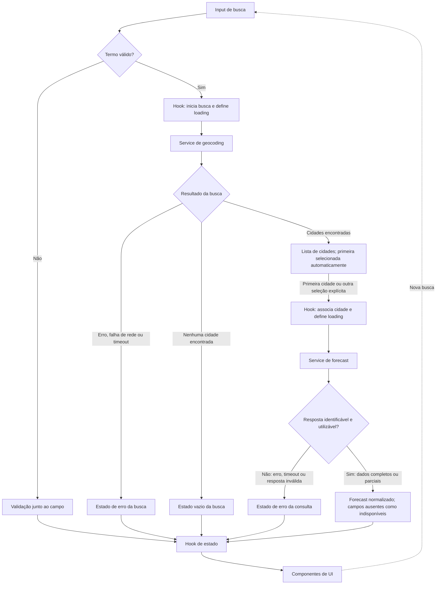

# Plano Técnico — Weather App

Este plano deriva de [specs/weather-app-spec.md](../specs/weather-app-spec.md), que é a fonte da verdade para escopo e comportamento. A seção External APIs detalha os contratos de integração; cobertura, limites e termos de uso da Open-Meteo ainda precisam de validação antes do lançamento.

## Architecture

Aplicação web client-side, sem autenticação, backend próprio ou persistência. A UI trata interação e apresentação; um hook coordena estados e solicitações; um service concentra chamadas HTTP, validação e normalização dos formatos externos; utilitários puros cuidam de datas, unidades e rótulos meteorológicos.

```text
React UI
  └─ useWeather (busca, seleção, unidade, estados e concorrência)
      └─ weatherService (HTTP, timeout, validação e normalização)
          ├─ Open-Meteo Geocoding API
          └─ Open-Meteo Forecast API
```

Uma resposta só pode atualizar a interface se ainda corresponder à busca ou cidade selecionada vigente. O navegador não mantém histórico: termos de busca e coordenadas não são gravados em armazenamento persistente nem em logs/analytics identificáveis (RF1, RF5, RF6, RNF8).

## Tech Stack

- **TypeScript strict, React e Vite:** stack definida pelo projeto; componentes e contratos tipados reduzem inconsistências entre API, estado e apresentação.
- **Tailwind CSS:** estilos responsivos e tema dark glassmorphism conforme o stack do projeto; implementar estados visíveis, foco e contraste da spec.
- **Open-Meteo Geocoding e Forecast:** fonte externa sem chave de API, conforme a spec; uso comercial, cobertura, limites e termos ainda são uma validação pré-lançamento.
- **Vitest e Testing Library:** testes unitários e de componentes, conforme o stack do projeto.
- **Playwright:** testes E2E dos fluxos e viewports definidos na spec.
- **Biome:** lint e formatação conforme o stack do projeto.

Não introduzir state manager, cache persistente, camada de backend ou biblioteca de datas sem necessidade demonstrada.

## Project Structure

```text
src/
  components/
    SearchBar.tsx           # Busca, validação e envio explícito
    CityResults.tsx         # Resultados distinguíveis e seleção explícita
    CurrentWeather.tsx      # Condições atuais e indisponibilidades
    ForecastList.tsx        # Cinco datas locais
    ForecastDayCard.tsx     # Métricas de um dia
    UnitToggle.tsx          # Controle Celsius/Fahrenheit
    states/
      LoadingState.tsx      # Estado textual e anunciado
      ErrorState.tsx        # Erro da operação e nova tentativa
      EmptyState.tsx        # Busca sem resultados
  hooks/
    useWeather.ts           # Estado da tela e coordenação de operações
  services/
    weatherService.ts       # Geocoding, forecast, timeout e normalização
  lib/
    temperature.ts          # Conversão e formatação de temperaturas
    weatherCodes.ts         # Rótulos pt-BR para códigos meteorológicos
    dates.ts                # Datas consecutivas no fuso selecionado
  types/
    weather.ts              # Tipos de domínio e estados
  App.tsx
  main.tsx
  styles/
    index.css
tests/
  unit/                     # Serviços, conversões, datas, códigos e componentes
  e2e/                      # Fluxos principais, responsividade e acessibilidade
```

Estrutura proposta; manter cada componente focado e evitar criar camadas adicionais sem necessidade (RNF2, RNF3).

## Data Model

Contratos de domínio independentes do formato bruto da API. Campos meteorológicos opcionais são `null` quando ausentes; `0` continua sendo um valor válido. Metadados necessários à identificação da resposta não são opcionais.

```ts
type TemperatureUnit = "celsius" | "fahrenheit";

interface City {
  id: string; // identidade estável do resultado, derivada do provedor
  name: string;
  administrativeArea: string | null;
  country: string | null;
  latitude: number;
  longitude: number;
}

interface CurrentWeather {
  temperatureC: number | null;
  apparentTemperatureC: number | null;
  relativeHumidityPercent: number | null;
  windSpeedKmh: number | null;
  precipitationMm: number | null;
  surfacePressureHpa: number | null;
  weatherCode: number | null;
}

interface ForecastDay {
  date: string; // data local ISO YYYY-MM-DD
  minTemperatureC: number | null;
  maxTemperatureC: number | null;
  weatherCode: number | null;
  precipitationProbabilityMaxPercent: number | null;
}

interface WeatherSnapshot {
  city: City;
  timezone: string;
  periodStart: string; // data local ISO YYYY-MM-DD
  current: CurrentWeather;
  forecast: ForecastDay[]; // exatamente cinco datas, inclusive dias sem métricas
}
```

O estado da tela distingue operação, carregamento, vazio, sucesso e erro, sem usar dados meteorológicos antigos para preencher campos ausentes:

```ts
type Operation = "search" | "weather";

type AsyncState<T> =
  | { status: "idle" }
  | { status: "loading"; operation: Operation }
  | { status: "success"; data: T }
  | { status: "empty" }
  | { status: "error"; operation: Operation; kind: "timeout" | "network" | "invalid-response" };

interface WeatherPageState {
  query: string;
  search: AsyncState<City[]>;
  selectedCity: City | null;
  weather: AsyncState<WeatherSnapshot>;
  unit: TemperatureUnit;
}
```

O erro de validação local de busca vazia é associado ao campo e não inicia uma solicitação. `id` pode usar o identificador fornecido pelo geocoding; se ausente, o service deve compor uma identidade não persistida com os dados do resultado, preservando a capacidade de distinguir resultados homônimos (AC1.2–AC1.4).

## Data Flow



1. A pessoa digita a cidade; o envio explícito remove somente espaços externos. Campo vazio não chama a API e recebe mensagem junto ao campo (AC1.1, AC1.4, AC1.5).
2. O hook define imediatamente o estado de busca como loading e o service consulta o geocoding. Resultados mostram nome, divisão administrativa e país quando disponíveis; coordenadas distinguem rótulos ainda idênticos. A primeira cidade é selecionada automaticamente para carregar o clima; a lista permite escolher outro resultado.
3. Busca vazia apresenta estado empty, não consulta o clima e não atribui à nova busca os dados de uma seleção anterior.
4. Ao selecionar explicitamente uma cidade, o hook define loading para weather e o service solicita as condições atuais e a previsão para as coordenadas selecionadas.
5. O service valida a estrutura, associa a resposta à cidade solicitada, exige fuso horário e período identificáveis, normaliza valores e constrói cinco datas consecutivas segundo a data local da cidade. Datas sem métricas permanecem no resultado com campos `null`.
6. A UI apresenta os dados válidos e marca cada campo ausente como indisponível. Mensagens de carregamento e erro são textuais e anunciadas por tecnologia assistiva.
7. A unidade vive na sessão da página, inicia em Celsius, e a apresentação converte de Celsius para a unidade escolhida. Alterná-la durante uma solicitação não muda cidade ou datas; os dados que chegarem são apresentados na unidade vigente.
8. Cada operação tem identidade ou geração de solicitação. Respostas de operações superadas são ignoradas; timeout, erro ou nova busca não podem deixar loading indefinido nem sobrescrever estado mais recente (AC1.7, AC2.2, AC5.3, AC5.5).

## External APIs

Todas as chamadas usam HTTPS e têm timeout de 10 segundos. Os exemplos abaixo são ilustrativos, com valores fictícios; não representam uma consulta meteorológica real. Os contratos atendem a RF1–RF6.

### Geocoding — busca de cidades

**Método e URL:** `GET https://geocoding-api.open-meteo.com/v1/search`

| Parâmetro | Valor / finalidade |
|---|---|
| `name` | Termo enviado explicitamente, sem espaços externos; preservar Unicode e codificar com `encodeURIComponent`. |
| `count` | `10`: limite inicial simples para a lista de resultados; a API aceita até 100. |
| `language` | `pt`: nomes traduzidos quando disponíveis; o provedor pode retornar nomes em inglês ou no idioma local. |
| `format` | `json`. |

`current`, `daily` e `timezone` não são parâmetros desta busca. O fuso pode aparecer em cada resultado, mas o modelo meteorológico usa o fuso retornado pelo forecast.

Exemplo de URL:

```text
https://geocoding-api.open-meteo.com/v1/search?name=S%C3%A3o%20Paulo&count=10&language=pt&format=json
```

Exemplo resumido de resposta:

```json
{
  "results": [
    {
      "id": 3448439,
      "name": "São Paulo",
      "latitude": -23.5475,
      "longitude": -46.6361,
      "admin1": "São Paulo",
      "country": "Brasil",
      "country_code": "BR",
      "timezone": "America/Sao_Paulo"
    }
  ]
}
```

**Mapeamento para `City`:**

| Origem em `results[i]` | Campo do modelo |
|---|---|
| `id` | `id`, convertido para string. |
| `name` | `name`. |
| `admin1` | `administrativeArea`; `null` quando ausente. |
| `country` | `country`; `null` quando ausente. |
| `latitude`, `longitude` | `latitude`, `longitude`, após validar números finitos e faixas geográficas. |

Campos como `country_code` e `timezone` não precisam ser duplicados em `City` para atender à spec. Validar o nome e a identidade utilizável antes de oferecer seleção; não inventar coordenadas ausentes. Quando não há correspondências, o provedor pode omitir `results`; a ausência em uma resposta JSON válida sem erro, ou um array vazio, significa lista vazia. Um `results` presente com estrutura inválida é falha, não “nenhuma cidade encontrada”.

A API não retorna correspondências para termos com um único caractere; o app não precisa proibir esse envio, apenas apresentar o estado vazio retornado. A primeira cidade é selecionada automaticamente, sem impedir seleção explícita de outra; incluir coordenadas quando nome, divisão administrativa e país não distinguirem os rótulos (AC1.2–AC1.6).

### Forecast — clima atual e cinco dias

**Método e URL:** `GET https://api.open-meteo.com/v1/forecast`

| Parâmetro | Valor / finalidade |
|---|---|
| `latitude`, `longitude` | Coordenadas da `City` selecionada. |
| `current` | `temperature_2m,apparent_temperature,relative_humidity_2m,wind_speed_10m,precipitation,surface_pressure,weather_code`. |
| `wind_speed_unit`, `precipitation_unit` | `kmh`, `mm`: unidades canônicas das métricas adicionais. |
| `daily` | `temperature_2m_min,temperature_2m_max,weather_code,precipitation_probability_max`. |
| `timezone` | `auto`: determina o fuso pelas coordenadas; as datas diárias começam à meia-noite local. |
| `forecast_days` | `5`: hoje e os quatro dias seguintes, no fuso consultado. |
| `temperature_unit` | `celsius`: unidade canônica do modelo; alternar para Fahrenheit não faz nova consulta. |
| `timeformat` | `iso8601`: datas e horários locais; manter datas diárias como `YYYY-MM-DD`. |

Exemplo de URL (quebras de linha apenas para leitura):

```text
https://api.open-meteo.com/v1/forecast
?latitude=-23.5475&longitude=-46.6361
&current=temperature_2m,apparent_temperature,relative_humidity_2m,wind_speed_10m,precipitation,surface_pressure,weather_code
&daily=temperature_2m_min,temperature_2m_max,weather_code,precipitation_probability_max
&timezone=auto&forecast_days=5&temperature_unit=celsius&timeformat=iso8601
&wind_speed_unit=kmh&precipitation_unit=mm
```

Exemplo resumido de resposta; metadados adicionais foram omitidos:

```json
{
  "latitude": -23.55,
  "longitude": -46.64,
  "timezone": "America/Sao_Paulo",
  "utc_offset_seconds": -10800,
  "current_units": {
    "time": "iso8601",
    "temperature_2m": "°C",
    "apparent_temperature": "°C",
    "relative_humidity_2m": "%",
    "wind_speed_10m": "km/h",
    "precipitation": "mm",
    "surface_pressure": "hPa",
    "weather_code": "wmo code"
  },
  "current": {
    "time": "2026-10-27T14:30",
    "temperature_2m": 25.2,
    "apparent_temperature": 26.1,
    "relative_humidity_2m": 64,
    "wind_speed_10m": 12.5,
    "precipitation": 0.2,
    "surface_pressure": 1013.2,
    "weather_code": 3
  },
  "daily_units": {
    "time": "iso8601",
    "temperature_2m_min": "°C",
    "temperature_2m_max": "°C",
    "weather_code": "wmo code",
    "precipitation_probability_max": "%"
  },
  "daily": {
    "time": ["2026-10-27", "2026-10-28", "2026-10-29", "2026-10-30", "2026-10-31"],
    "temperature_2m_min": [18.5, 19.0, 17.8, 18.1, 19.2],
    "temperature_2m_max": [27.2, 28.0, 25.6, 26.4, 29.1],
    "weather_code": [3, 61, 3, 2, 1],
    "precipitation_probability_max": [20, 80, 35, 10, 5]
  }
}
```

**Mapeamento para os tipos de domínio:**

| Origem | Destino |
|---|---|
| `current.temperature_2m` | `CurrentWeather.temperatureC`. |
| `current.apparent_temperature` | `CurrentWeather.apparentTemperatureC`. |
| `current.relative_humidity_2m` | `CurrentWeather.relativeHumidityPercent`. |
| `current.wind_speed_10m` | `CurrentWeather.windSpeedKmh`, em km/h. |
| `current.precipitation` | `CurrentWeather.precipitationMm`, acumulado no intervalo atual em mm. |
| `current.surface_pressure` | `CurrentWeather.surfacePressureHpa`, em hPa. |
| `current.weather_code` | `CurrentWeather.weatherCode`. |
| `daily.time[i]` | `ForecastDay.date`. |
| `daily.temperature_2m_min[i]` | `ForecastDay.minTemperatureC`. |
| `daily.temperature_2m_max[i]` | `ForecastDay.maxTemperatureC`. |
| `daily.weather_code[i]` | `ForecastDay.weatherCode`. |
| `daily.precipitation_probability_max[i]` | `ForecastDay.precipitationProbabilityMaxPercent`. |
| Cidade selecionada vinculada à solicitação | `WeatherData.city`. |
| `timezone` | `WeatherData.timezone`. |
| Data local de referência validada para a consulta | `WeatherData.periodStart`. |
| Objeto `current` normalizado | `WeatherData.current`. |
| Arrays `daily` agrupados por data | `WeatherData.forecast`. |

`WeatherData` é o nome proposto para o agregado chamado `WeatherSnapshot` na seção Data Model; são o mesmo contrato, não dois modelos a manter. Da mesma forma, `Unit` corresponde a `TemperatureUnit`: `"celsius" | "fahrenheit"`, exclusivamente para apresentação.

**Regras de normalização e validação:**

- O forecast não retorna o nome da cidade nem o identificador do geocoding. Vincular a resposta à cidade e à geração da solicitação; descartar respostas superadas. As coordenadas retornadas podem corresponder à célula de previsão, não ser idênticas às coordenadas enviadas.
- Validar o fuso IANA e um período identificável. Determinar hoje no fuso retornado, não por `new Date().toISOString()` nem pelo fuso do dispositivo. Conferir as datas da resposta contra esse período; se uma consulta atravessar a meia-noite local e o período ficar desatualizado, refazer a consulta para o novo hoje em vez de rotular ontem como hoje.
- Os arrays de `daily` são paralelos: o índice de uma métrica corresponde a `daily.time[i]`. Agrupar por essa data antes de gerar os cinco dias; não deslocar valores para compensar posições ausentes.
- Para cada uma das cinco datas esperadas, criar um `ForecastDay`. Dia ausente mantém a data com métricas `null`; elementos ausentes, `null` ou inválidos também se tornam `null`. Percentuais válidos ficam entre 0 e 100; zero não é ausência.
- Ausência de métricas atuais pode produzir `CurrentWeather` com campos `null` se identidade, fuso, período e estrutura ainda forem utilizáveis. Sem esses metadados, rejeitar a resposta em vez de fabricar um período a partir de dados locais (AC6.1–AC6.3).
- Códigos `weather_code` são códigos WMO, não textos traduzidos. Derivar descrições pt-BR na UI; um código desconhecido deve aparecer como condição indisponível, nunca como “céu limpo” por padrão.
- Conferir as unidades declaradas para métricas presentes, sem presumir Fahrenheit ou converter valores duas vezes. Renderizar todas as temperaturas com uma casa decimal e unidade explícita; preservar cidade e datas ao alternar `Unit`.
- Tratar status HTTP não bem-sucedido e respostas de erro do provedor como falha da operação, não como resposta parcial. Erros de parâmetros podem incluir `{"error": true, "reason": "..."}`; mostrar mensagem pt-BR apropriada sem expor o corpo bruto.

**Referências oficiais:** [Geocoding API](https://open-meteo.com/en/docs/geocoding-api) e [Forecast API](https://open-meteo.com/en/docs). Esta documentação não aprova uso comercial nem garante cobertura ou disponibilidade: limites, licença, atribuição exigida e eventual plano comercial continuam como verificações de lançamento.

## State Management

`App` consome `useWeather` para status, dados, erros, busca e retry, iniciando
em `idle`. O mock e o seletor de estados não participam da tela real.
A unidade é estado React local independente do hook, sem persistência e sem
requisições ao alternar. `CurrentWeather` e `ForecastDayCard` recebem essa
unidade e convertem temperaturas somente na renderização.
`ForecastList` preserva a ordem e as cinco datas ISO locais; rótulos são
formatados com fuso UTC explícito para não deslocar uma data sem horário.
O bootstrap importa Tailwind global e monta `App`. `ErrorState` recebe a
mensagem do hook e chama `retry`; o foco passa ao conteúdo principal para não
se perder quando o botão sai da tela. Os dados só são renderizados em
`success` com snapshot disponível. A lista de seleção de cidades permanece
para etapa posterior.

Estado local React encapsulado em `useWeather`; sem store global porque a tela e a preferência são de escopo único. Separar o termo de busca, resultados, cidade selecionada, dados meteorológicos e unidade impede confundir o resultado da busca com o clima atualmente selecionado.

O contrato público inicial do hook expõe `status` (`idle | loading | success | error | empty`), `data: WeatherData | null`, `cities: City[]`, `error: string | null`, `query: string` e ações assíncronas `search(name)`, `selectCity(city)` e `retry()`. O status agrega busca e forecast, permanecendo `loading` até o clima resolver. Cada nova operação remove dados e erros anteriores; nova busca limpa também a lista. `retry()` repete a última chamada de serviço: geocoding se a busca falhou, forecast da cidade se essa etapa já iniciou. Sem operação anterior, não faz nada. Busca vazia expõe erro de validação sem rede. A unidade continua na UI neste incremento; os estados separados do modelo acima ficam para evolução posterior.

- Unidade inicial: Celsius em cada carga da página; sem `localStorage`, cookies ou persistência.
- A seleção da unidade é independente dos dados e não inicia nova consulta.
- Resultados meteorológicos são associados à cidade selecionada; ao selecionar outra cidade, dados anteriores não podem ser apresentados como atuais.
- Identificadores de requisição/`AbortController` evitam que respostas tardias substituam estado recente; cancelamento não substitui a checagem de identidade da resposta.
- Não reter nem enviar à telemetria termos de busca ou coordenadas que identifiquem a cidade.

## Error Handling

- **Validação local:** busca vazia ou apenas espaços mostra erro junto ao campo; não chama a API.
- **Loading:** indicar imediatamente e por texto qual operação está em curso (busca ou consulta meteorológica).
- **Timeout:** limitar cada solicitação a 10 segundos com `fetchWithTimeout` e `AbortController`, limpando o temporizador em `finally`; converter `AbortError` em `WeatherServiceError` com categoria `timeout` e mensagem “A requisição demorou demais.”. Falhas de rede usam categoria `network` e mensagem “Falha de rede.”. Na UI, finalizar loading e oferecer nova tentativa da mesma operação.
- **Falha de rede/API:** encerrar loading, mostrar erro correspondente à operação e permitir retry quando aplicável. Não capturar falhas silenciosamente.
- **Resposta inválida:** tratar ausência de identidade da cidade, fuso horário, período ou estrutura utilizável como falha; não renderizar valores inválidos.
- **Resposta parcial:** manter os dados válidos e apresentar os campos ausentes como indisponíveis; nunca substituir por zero, valor antigo ou inventado.
- **Sem resultados:** estado vazio dedicado; não iniciar consulta meteorológica.
- **Concorrência:** descartar respostas de requisições vencidas ou de uma cidade que deixou de estar selecionada.
- **Acessibilidade:** estados e mensagens visíveis, anunciados por tecnologia assistiva e não comunicados apenas por cor; todas as ações têm foco visível e operação por teclado.

## Testing Strategy

- **Unitários (Vitest):**
  - Normalização da busca: espaços externos, Unicode, acentos, hífens e apóstrofos.
  - Conversão e formatação °C/°F, uma casa decimal, casos de referência `0 °C = 32,0 °F` e `32 °F = 0,0 °C`; ausência não vira zero.
  - Mapeamento de códigos meteorológicos para rótulos em pt-BR.
  - Datas locais consecutivas no fuso da cidade, incluindo virada do dia e discrepância com UTC; preenchimento dos cinco dias com métricas ausentes.
  - Service com respostas completas, parciais, inválidas, sem resultados, erro de rede e timeout; uso de mocks, sem depender da API externa.
  - Concorrência: resposta antiga de busca/clima não substitui a solicitação vigente.
- **Componentes (Testing Library):** validação no campo, resultados homônimos e seleção explícita, estados loading/error/empty, campos indisponíveis, retry, unidade selecionada e atualização de todas as temperaturas sem alterar cidade/datas.
- **E2E (Playwright):** fluxos completos de busca → seleção → clima e previsão → alternância de unidade; nenhum resultado e retry; respostas tardias; teclado e anúncios acessíveis. Interceptar/mocar APIs para determinismo.
- **Responsividade e compatibilidade:** verificar viewports de 320, 768, 1024 e 1440 px, ausência de rolagem horizontal e legibilidade/operação; validar navegadores indicados na RNF7 no pipeline de lançamento.
- **Metas operacionais:** acompanhar P95 de até 3 s nas solicitações bem-sucedidas quando a fonte estiver disponível, erros/timeouts em indicadores separados e disponibilidade sintética da aplicação (RNF1, RNF4). A disponibilidade da Open-Meteo deve ser medida separadamente.

## Risks & Trade-offs

| Risco / trade-off | Decisão ou mitigação |
|---|---|
| Divergência entre nomes/disponibilidade dos campos previstos e a API atual | Validar endpoints, parâmetros, variáveis, cobertura, limites e termos oficiais antes do lançamento; manter normalização e validação isoladas no service. É bloqueio de lançamento da spec. |
| Indisponibilidade ou latência do provedor externo | Timeout de 10 s, retry explícito, estados finais claros e métricas separadas para aplicação e provedor; sem cache persistente para evitar exibir dados antigos como atuais. |
| Resposta parcial ou tardia induzir interpretação errada | Valores ausentes como `null`/indisponíveis, metadados obrigatórios validados e respostas superadas descartadas. |
| Cidades homônimas | Seleção nunca automática; localização administrativa, país e coordenadas quando necessários para desambiguar. |
| Cálculo incorreto do “hoje” perto da mudança de data | Usar o fuso retornado para gerar o período local de cinco datas, nunca o fuso do dispositivo ou UTC. |
| Conversão de unidade em diferentes momentos de carregamento | Armazenar temperaturas normalizadas em Celsius e converter apenas na apresentação; alternância não altera consulta, cidade nem datas. |
| Simplicidade versus robustez | Manter estado React local, sem backend, cache, store ou persistência. Isso reduz complexidade, mas deixa disponibilidade e latência do clima dependentes do navegador e do provedor. |
| Privacidade e metas ainda não aprovadas | Não persistir termos/coordenadas nem incluí-los em logs identificáveis; aprovação da política de privacidade, metas de performance/disponibilidade e validação dos termos comerciais são condições de lançamento. |
